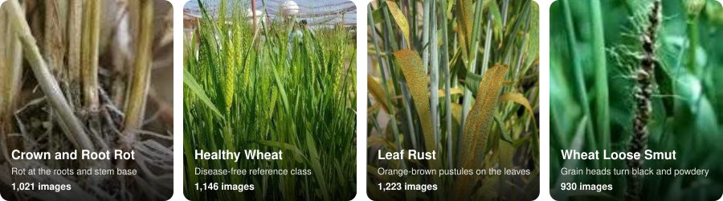
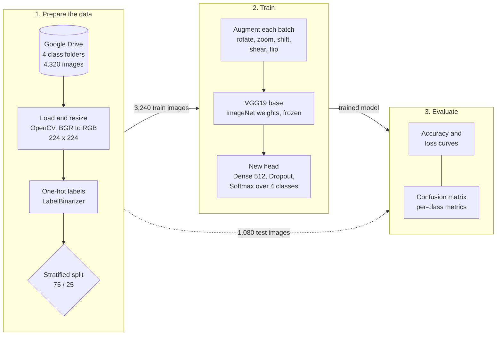
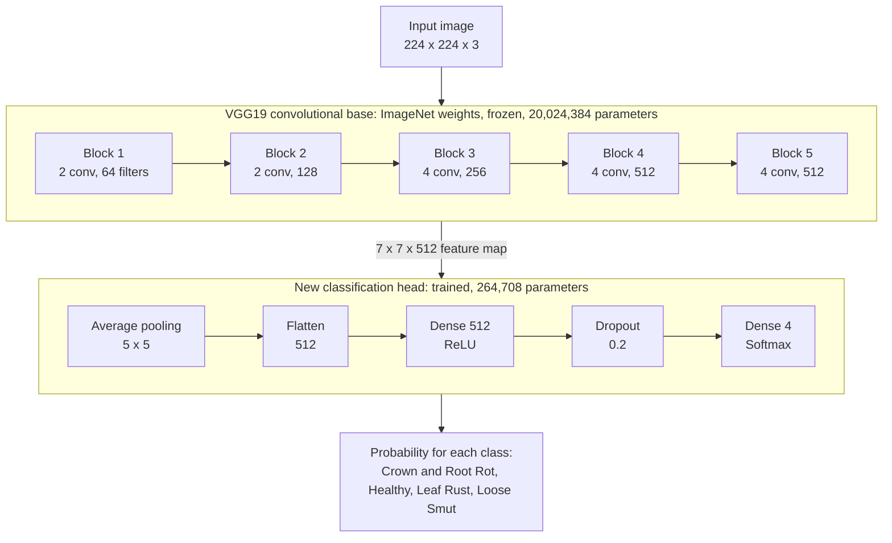
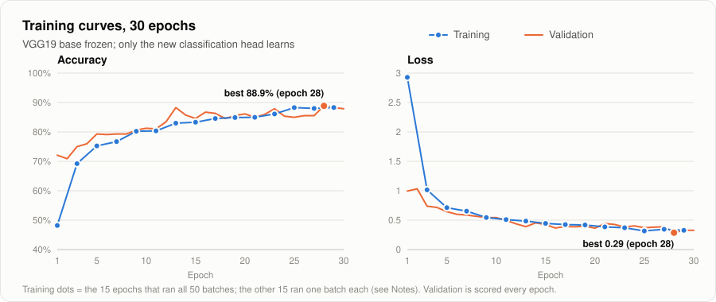
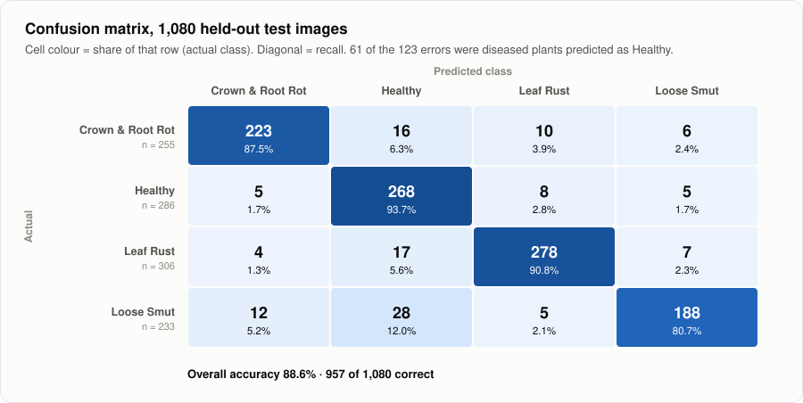
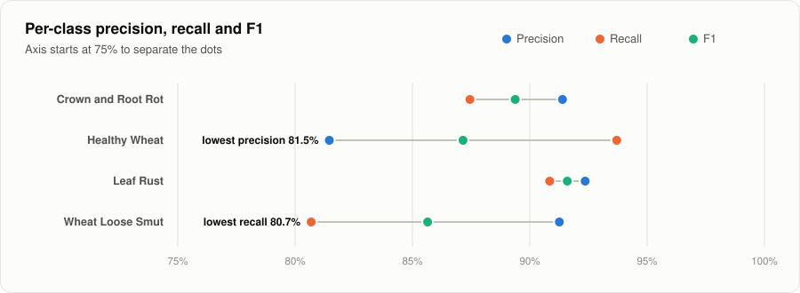
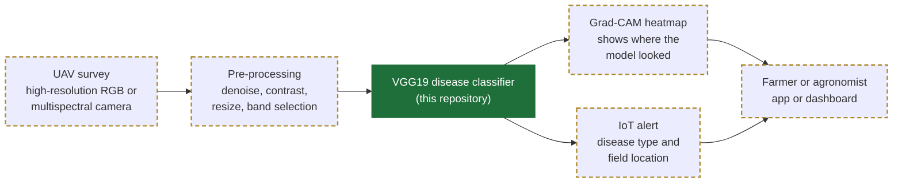

<p align="center">
  
</p>

<p align="center">
  <a href="https://colab.research.google.com/github/rohancooks/Advance-Wheat-Disease-Detector/blob/main/Wheat_Disease_Detection_final.ipynb"></a>
  
  
  
  
  
  <a href="https://www.researchgate.net/publication/392375442_Advancing_Smart_Farming_with_UAV-Based_Deep_Learning_for_Proactive_Wheat_Disease_Management"></a>
</p>

**Advanced Wheat Disease Detector** is a deep-learning model that looks at a photo of a wheat plant and says which of four classes it belongs to: **Crown and Root Rot**, **Leaf Rust**, **Wheat Loose Smut** or **Healthy Wheat**. It reuses a VGG19 network already trained on ImageNet and only trains a small new classification head on top. That makes it accurate with just 4,320 images and quick to train on a free Colab GPU.

It is the code behind our IEEE STCR 2025 paper, *Advancing Smart Farming with UAV-Based Deep Learning for Proactive Wheat Disease Management*. The paper places this classifier inside a bigger system: drones survey the field, the model flags diseased patches, and farmers get an alert early enough to act.

### Results at a glance

| Metric | Result |
|---|---|
| **Test accuracy** | **88.6%**: 957 of 1,080 images the model never saw while training |
| **Macro F1 score** | 0.884 across the four classes |
| **Best validation accuracy** | 88.9% (epoch 28 of 30) |
| **Dataset** | 4,320 images, 4 classes, split 75 / 25 |
| **Parameters trained** | 264,708 of 20.3 million (the VGG19 base stays frozen) |
| **Training time** | about 21 minutes on Google Colab |

---

## Contents

1. [Why wheat disease detection](#why-wheat-disease-detection)
2. [The four classes](#the-four-classes)
3. [How it works](#how-it-works)
4. [Dataset](#dataset)
5. [Model architecture](#model-architecture)
6. [Training setup](#training-setup)
7. [Results](#results)
8. [From notebook to field: the full system](#from-notebook-to-field-the-full-system)
9. [Run it yourself](#run-it-yourself)
10. [Notes for reproducing and improving](#notes-for-reproducing-and-improving)
11. [Repository structure](#repository-structure)
12. [Paper and citation](#paper-and-citation)

---

## Why wheat disease detection

Wheat is one of the world's main staple crops, and fungal diseases can wipe out a large share of a harvest if nobody catches them early. Today that usually means a specialist walking the field and inspecting plants by eye. That is slow, costly, easy to get wrong, and impossible to do often across a large farm.

Image-based deep learning can do that first check automatically. If a model can tell a diseased plant from a healthy one in a photo, a drone or a phone camera can screen a whole field. People then only need to look where the model raises a flag. This project builds and evaluates that classifier.

## The four classes

<p align="center">
  
</p>

| Class | What it is | What you can see | Images |
|---|---|---|---:|
| **Crown and Root Rot** | Fungal infection of the roots and the base of the stem | Browning and rot at the plant base; plants wilt and yield drops | 1,021 |
| **Leaf Rust** | Common fungal infection of the leaves | Orange-brown pustules scattered over the leaf blades, cutting photosynthesis | 1,223 |
| **Wheat Loose Smut** | Fungal disease of the grain head | Heads turn black and powdery in place of grain, so the seed is lost | 930 |
| **Healthy Wheat** | Disease-free plants, used as the reference class | Even green leaves and normal heads | 1,146 |

<sub>Photos from Fig. 1 of the paper. The images come from the dataset published by Fang, Zhen and Li (2023), credited under <a href="#dataset">Dataset</a>.</sub>

## How it works

The whole pipeline lives in one notebook, [`Wheat_Disease_Detection_final.ipynb`](Wheat_Disease_Detection_final.ipynb):



Step by step, with the notebook cells each step lives in:

1. **Mount the data (cells 0–1).** The images sit in Google Drive with one folder per class. The folder name is the label.
2. **Load every image (cell 7).** OpenCV reads each file and converts it from BGR to RGB. Each image is resized to 224 × 224, the input size VGG19 expects. Loading all 4,320 images takes about 7 minutes.
3. **Encode and split (cell 10).** `LabelBinarizer` turns the class names into one-hot vectors. `train_test_split` holds back 25% for testing (`stratify=labels`, `random_state=42`), so every class keeps the same share in both sets.
4. **Augment the training images (cell 11).** Each training batch is randomly rotated, zoomed, shifted, sheared and flipped. The model never sees the exact same picture twice, so it learns the disease rather than the photo. Test images are left untouched.
5. **Build the model (cell 12).** It loads VGG19 without its ImageNet classifier and freezes it, then adds a new head that ends in four outputs ([details below](#model-architecture)).
6. **Train (cell 13).** 30 epochs with Adam and categorical cross-entropy, in batches of 64.
7. **Evaluate (cells 14–15).** The notebook plots accuracy and loss curves, then predicts all 1,080 test images for the confusion matrix.

## Dataset

The images come from the dataset released with **Fang, X., Zhen, T. and Li, Z. (2023), "Lightweight Multiscale CNN Model for Wheat Disease Detection", *Applied Sciences* 13(9), 5801** ([doi:10.3390/app13095801](https://doi.org/10.3390/app13095801)). It mixes plain and cluttered backgrounds and disease at different stages, which makes it a fair test of real-world robustness. The images are **not** stored in this repository.

The notebook expects this layout:

```text
Large Wheat classification detection/
├── Crown and Root Rot/    1,021 images
├── Healthy Wheat/         1,146 images
├── Leaf Rust/             1,223 images
└── Wheat Loose Smut/        930 images
```

The classes are fairly balanced: the largest is only 1.3× the smallest. The stratified split gives:

| Class | Total | Train (75%) | Test (25%) |
|---|---:|---:|---:|
| Crown and Root Rot | 1,021 | 766 | 255 |
| Healthy Wheat | 1,146 | 860 | 286 |
| Leaf Rust | 1,223 | 917 | 306 |
| Wheat Loose Smut | 930 | 697 | 233 |
| **Total** | **4,320** | **3,240** | **1,080** |

## Model architecture

The model uses **transfer learning**. VGG19 has already learned general visual features (edges, textures, colour patches, shapes) from about a million ImageNet photos. Those features work well for spotting rust pustules, blackened heads and rotting stems. Training a 20-million-parameter network from scratch on 4,320 images would overfit badly. Instead, the pretrained base is frozen and only a small head is trained to map its features onto the four wheat classes.



Each VGG block is a stack of 3 × 3 convolutions with ReLU, followed by max pooling. The pooling halves the image each time: 224 → 112 → 56 → 28 → 14 → 7.

| Stage | Output shape | Parameters | Trained? |
|---|---|---:|:---:|
| Input | 224 × 224 × 3 | – | – |
| VGG19 base (16 conv layers, 5 max-pool layers) | 7 × 7 × 512 | 20,024,384 | No (frozen) |
| `AveragePooling2D(5 × 5)` | 1 × 1 × 512 | 0 | – |
| `Flatten` | 512 | 0 | – |
| `Dense(512, relu)` | 512 | 262,656 | Yes |
| `Dropout(0.2)` | 512 | 0 | – |
| `Dense(4, softmax)` | 4 | 2,052 | Yes |
| **Total** | | **20,289,092** | **264,708 trained** |

**Why VGG19?** It is a simple, well-studied stack of small convolutions with reliable ImageNet weights. That makes it a strong, easy-to-explain baseline for plant disease classification, and its plain structure suits Grad-CAM explanations, which the paper plans to add.

## Training setup

| Setting | Value |
|---|---|
| Optimiser | Adam (default learning rate 0.001) |
| Loss | Categorical cross-entropy |
| Batch size | 64 |
| Epochs | 30 |
| Input | 224 × 224 RGB |
| Augmentation | rotation ±30°, zoom ±15%, width and height shift ±20%, shear 0.15, horizontal flip, nearest-pixel fill |
| Regularisation | Frozen base, dropout 0.2, augmentation |
| Platform | Google Colab, TensorFlow 2.18 with Keras 3 |

## Results

### Training curves

<picture>
  <source media="(prefers-color-scheme: dark)" srcset="assets/training-dark.svg">
  
</picture>

- **Validation accuracy climbs fast and then levels off.** It goes from 72% after the first epoch to around 88%, peaking at **88.9% at epoch 28**. Most of the gain comes in the first 13 epochs.
- **Validation loss falls from 0.99 to 0.29** and flattens out. With the base frozen, the head has learned most of what it can, so more epochs alone would add little.
- **Training and validation track each other closely**, with no growing gap, so the model is not overfitting. The frozen base, dropout and augmentation keep it general.

### Confusion matrix

<picture>
  <source media="(prefers-color-scheme: dark)" srcset="assets/confusion-dark.svg">
  
</picture>

### Per-class performance

<picture>
  <source media="(prefers-color-scheme: dark)" srcset="assets/metrics-dark.svg">
  
</picture>

| Class | Precision | Recall | F1 | Test images |
|---|---:|---:|---:|---:|
| Crown and Root Rot | 91.4% | 87.5% | 0.894 | 255 |
| Healthy Wheat | 81.5% | 93.7% | 0.872 | 286 |
| Leaf Rust | 92.4% | 90.8% | **0.916** | 306 |
| Wheat Loose Smut | 91.3% | 80.7% | 0.856 | 233 |
| **Macro average** | **89.1%** | **88.2%** | **0.884** | **1,080** |

<sub><b>Precision</b>: of the images the model called this class, how many really were. <b>Recall</b>: of the images that really were this class, how many the model found. <b>F1</b> balances the two.</sub>

**What the numbers say:**

- **Leaf Rust is the easiest class to recognise** (F1 0.916), most likely because its orange-brown pustules contrast so sharply with green leaf tissue.
- **Errors lean towards "Healthy".** Healthy Wheat has the highest recall (93.7%) but the lowest precision (81.5%). Of the 123 test errors, **61 were diseased plants labelled Healthy**. For a farmer, that is the costly mistake: a missed infection, not a wasted inspection. Class weights or a stricter threshold for "Healthy" are the obvious next fixes.
- **Wheat Loose Smut is the hardest class to catch** (recall 80.7%). 28 of its 233 test images were called Healthy and 12 were called Crown and Root Rot.
- **The model tells the diseases apart better than it tells sick from healthy.** 44 of the 123 errors swap one disease for another. 61 are diseased plants called Healthy, and 18 are healthy plants flagged as diseased.

> **About the numbers in the paper:** the paper reports about 90% validation accuracy and 95% training accuracy from an earlier training run. Every figure in this README is recomputed from the run saved in this notebook, so it describes the exact code and outputs in this repository.

## From notebook to field: the full system

The paper describes a full precision-farming system. This repository holds its core, the disease classifier. The rest is the deployment roadmap:



| Component | In the paper | In this repository |
|---|:---:|:---:|
| VGG19 transfer-learning classifier | ✅ | ✅ |
| Data augmentation | ✅ | ✅ |
| Accuracy and loss curves, confusion matrix | ✅ | ✅ |
| UAV image capture over large fields | ✅ | 🔜 |
| Multispectral bands beyond RGB | ✅ | 🔜 |
| Grad-CAM explanations for farmers | ✅ | 🔜 |
| IoT real-time disease alerts | ✅ | 🔜 |
| Mobile and edge deployment | Future work | 🔜 |

## Run it yourself

### Option A: Google Colab (recommended)

1. Click **[Open in Colab](https://colab.research.google.com/github/rohancooks/Advance-Wheat-Disease-Detector/blob/main/Wheat_Disease_Detection_final.ipynb)**.
2. Put the dataset in your Google Drive as `MyDrive/Large Wheat classification detection/`, with the four class folders inside. If you use another location, update `dataset` in cell 4 and the four `*_PATH` variables in cell 5.
3. Choose **Runtime → Change runtime type → GPU**.
4. Choose **Runtime → Run all** and allow Drive access when asked. Loading the images takes about 7 minutes and training about 21.

### Option B: local Jupyter

```bash
git clone https://github.com/rohancooks/Advance-Wheat-Disease-Detector.git
```

```bash
pip install tensorflow opencv-python imutils scikit-learn matplotlib seaborn tqdm notebook
```

```bash
jupyter notebook Wheat_Disease_Detection_final.ipynb
```

Skip cell 0 (`drive.mount`) and point the paths in cells 4–5 at your local copy of the dataset. A GPU is strongly recommended.

### Classify a new photo

After training, in the same notebook session:

```python
import cv2
import numpy as np

img = cv2.cvtColor(cv2.imread("my_wheat_photo.jpg"), cv2.COLOR_BGR2RGB)
img = cv2.resize(img, (224, 224)).astype("float32")   # same preprocessing as training

probs = final_model.predict(img[np.newaxis])[0]
for name, p in sorted(zip(lb.classes_, probs), key=lambda x: -x[1]):
    print(f"{name:20s} {p:6.1%}")
```

To keep the trained model for later, save it together with the label encoder:

```python
import pickle
final_model.save("wheat_vgg19.keras")
pickle.dump(lb, open("lb.pickle", "wb"))
```

## Notes for reproducing and improving

<details>
<summary><b>Seven implementation details found while documenting the notebook</b> (click to expand)</summary>

<br>

1. **Two labels are swapped in the notebook's confusion-matrix plot.** Cell 15 takes its tick labels from `os.listdir()`. The model's outputs follow `LabelBinarizer`'s alphabetical order (`lb.classes_`). As a result, the plot shows the *Healthy Wheat* and *Leaf Rust* rows and columns under each other's names. The row totals prove it: 286 and 306 are 25% of the 1,146 Healthy and 1,223 Leaf Rust images. The figures in this README use the correct order. Fix: `xticklabels=lb.classes_, yticklabels=lb.classes_`.
2. **Every second epoch trains on a single batch.** The training generator yields 51 batches per pass, but `steps_per_epoch=len(trainX)//64` asks for 50. The leftover batch carries into the next epoch, which then runs out of data after one step. That is the `Your input ran out of data` warning in the log. In effect the model got 15 full epochs, not 30. Fix: remove `steps_per_epoch` and `validation_steps` and let Keras use the generator's own length.
3. **Per-epoch validation sees only about half the test set.** `valAug.flow()` uses its default batch size of 32, but `validation_steps=len(testX)//64` asks for 16 batches, which is 512 of the 1,080 images. The final confusion matrix does use all 1,080.
4. **ImageNet mean subtraction is configured but never applied.** Setting `trainAug.mean` does nothing unless `featurewise_center=True`, so the model trains on raw 0–255 pixels. That still works because the new head adapts, but `tf.keras.applications.vgg19.preprocess_input` would match how VGG19 was pretrained and often helps.
5. **The pooling layer ignores part of the image.** `AveragePooling2D(5 × 5)` on the 7 × 7 feature map uses a stride of 5 and no padding, so it averages only the top-left 5 × 5 window. 24 of the 49 feature positions, the bottom and right edges of the image, never reach the classifier. `GlobalAveragePooling2D()` would use all of them.
6. **The test set also serves as the validation set.** Nothing was tuned on it (no early stopping, no checkpoint picking), so the final numbers remain a fair held-out estimate. A separate validation split would still be cleaner once tuning starts.
7. **The trained model is not saved.** The notebook defines `lb.pickle` but never writes it. Use the save snippet under [Classify a new photo](#classify-a-new-photo).

</details>

**Next steps**

- [ ] Apply the fixes above and re-train. Items 2, 4 and 5 are the ones most likely to raise accuracy.
- [ ] Unfreeze VGG19's last block and fine-tune it at a low learning rate (about 1e-5).
- [ ] Use class weights or a stricter "Healthy" threshold to cut missed infections.
- [ ] Add Grad-CAM overlays so every prediction shows the leaf area that drove it.
- [ ] Compare lighter backbones (EfficientNet-B0, MobileNetV3) and export to TensorFlow Lite for drones and phones.
- [ ] Bring in UAV multispectral imagery and IoT alerting, as described in the paper.

## Repository structure

```text
Advance-Wheat-Disease-Detector/
├── Wheat_Disease_Detection_final.ipynb      # full pipeline: load → augment → train → evaluate
├── IEEE-STCR-2025_paper_1984.pdf            # the published paper
├── Advanced-Wheat-Disease-Predictor-main (1).zip   # archive of the original upload (same files)
├── assets/                                  # README figures (SVG, light and dark versions)
│   └── make_figures.py                      # rebuilds every figure from the notebook and the paper
└── README.md
```

Rebuild the figures with `python assets/make_figures.py`. It uses only the Python standard library.

## Paper and citation

**Advancing Smart Farming with UAV-Based Deep Learning for Proactive Wheat Disease Management**
Rohan Thakur, Ronald Ekka, Yash Kumar, Poornima Mittal. Department of Electronics and Communication Engineering, Delhi Technological University, Delhi, India.
*2025 Smart Technologies, Communication & Robotics (STCR)*, IEEE, 9–10 May 2025, Sathyamangalam, India.

📄 [Read the paper (PDF in this repo)](IEEE-STCR-2025_paper_1984.pdf) · 🔗 [ResearchGate](https://www.researchgate.net/publication/392375442_Advancing_Smart_Farming_with_UAV-Based_Deep_Learning_for_Proactive_Wheat_Disease_Management)

<details>
<summary><b>Abstract</b></summary>

<br>

Wheat diseases are a huge risk to the food security of the world and can result in extreme yield loss in case they are not diagnosed and treated at an early stage. Previously, disease identification required manual scanning, which is labor intensive, time-consuming, and inaccurate. The project shows a real-time, scalable, and automated wheat disease detection system with Unmanned Aerial Vehicles (UAVs), multispectral sensing, and deep learning. The system described above is unlike the conventional ground-based methods, the model uses aerial imagery collected using UAVs in conjunction with deep Convolutional Neural Networks (CNNs), specifically fine-tuned VGG19, to enhance scalability and accuracy. Grad-CAM visualization is also integrated to make predictions from models interpretable by farmers. In addition, the system incorporates real-time processing as well as IoT for automated early disease intervention alerting. The combination of large-scale monitoring, high-accuracy disease detection, and farmer-friendly deployment, this project fills important gaps in existing research with a pioneering, field-application solution for precision agriculture. Experimental results show high detection accuracy, proving its robustness under varying environmental conditions. This technology allows farmers to obtain real-time information, enabling timely disease management and sustainable wheat production.

</details>

```bibtex
@inproceedings{thakur2025wheat,
  title     = {Advancing Smart Farming with {UAV}-Based Deep Learning for Proactive Wheat Disease Management},
  author    = {Thakur, Rohan and Ekka, Ronald and Kumar, Yash and Mittal, Poornima},
  booktitle = {2025 Smart Technologies, Communication and Robotics (STCR)},
  address   = {Sathyamangalam, India},
  publisher = {IEEE},
  year      = {2025}
}
```

## Acknowledgements

- **Dataset:** Fang, X., Zhen, T. and Li, Z. (2023), *Lightweight Multiscale CNN Model for Wheat Disease Detection*, Applied Sciences 13(9), 5801.
- **Model:** Simonyan, K. and Zisserman, A. (2014), *Very Deep Convolutional Networks for Large-Scale Image Recognition* ([arXiv:1409.1556](https://arxiv.org/abs/1409.1556)), the paper that introduced VGG19.
- Built with TensorFlow / Keras, OpenCV, scikit-learn, seaborn and Google Colab.
